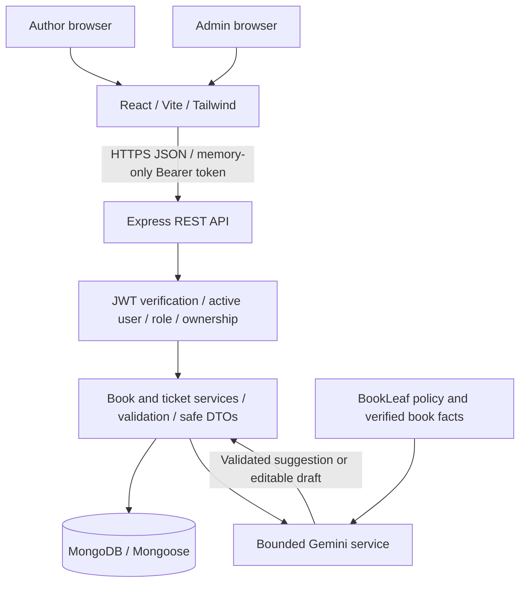

# BookLeaf Author Support & Communication Portal

An author-support application with separate author and operations workspaces, authenticated Books and Tickets APIs, and backend-only Gemini classification and response drafting.

**Submission status:** local development is working; deployment and public repository publication are pending. Two direct Gemini smoke requests passed. Broader AI quality and deployed end-to-end workflows remain unverified. See [test evidence](#8-verification-and-test-evidence) and [assessment access](#12-live-demo-and-assessment-access).

## Contents

1. [Overview and features](#1-overview-and-features)
2. [Technology and architecture](#2-technology-and-architecture)
3. [Prerequisites and local setup](#3-prerequisites-and-local-setup)
4. [Environment configuration](#4-environment-configuration)
5. [MongoDB and original sample data](#5-mongodb-and-original-sample-data)
6. [Gemini AI integration](#6-gemini-ai-integration)
7. [REST API](#7-rest-api)
8. [Verification and test evidence](#8-verification-and-test-evidence)
9. [Security](#9-security)
10. [Render and Vercel deployment](#10-render-and-vercel-deployment)
11. [Known limitations and improvements](#11-known-limitations-and-improvements)
12. [Live demo and assessment access](#12-live-demo-and-assessment-access)
13. [Supporting documentation and submission](#13-supporting-documentation-and-submission)

## 1. Overview and features

| Author portal | Admin operations portal |
| --- | --- |
| Email/password login and author-scoped data | Active-admin authorization |
| Book details: title, ISBN, genre, publication date, status, MRP, copies sold and earned/paid/pending royalties | Queue filters by status, category, priority, assignee and inclusive UTC creation dates |
| Book-specific or General / Account Level tickets | Global urgency/age ordering, assignment and lifecycle management |
| Public replies and latest-first conversation history | AI category/priority suggestions with manual overrides and review provenance |
| Near-real-time updates through polling | Initial editable AI drafts, explicit review and separate send action |
| Optional file selection with an explicit no-upload notice | Separate public replies and private internal notes |

Dashboard counts come from API data. No fake records or metrics are embedded in the application. Source nulls, in-production books and placeholder ISBNs remain intact. Optional attachment selection is implemented; upload/storage is not. Polling satisfies the assignment's near-real-time option; Socket.IO is not required or installed.

## 2. Technology and architecture

| Layer | Choice and rationale |
| --- | --- |
| Frontend | React 19, Vite 8 and Tailwind CSS 4; JavaScript/JSX, reusable components and responsive layouts |
| Backend | Node.js and Express 5 ES modules; routing, validation, services, database access and DTO serialization remain separate |
| Persistence | MongoDB with Mongoose 9; references avoid copying full author/book records into tickets, transactions keep activity atomic |
| Authentication | bcrypt password hashes and short-lived JWTs; server-side role/ownership checks remain the access boundary |
| AI | Official `@google/genai` SDK 2.31.0; structured classification and short policy-grounded drafts through the backend only |
| Updates | Twenty-second polling with cancellation and editing protection; less infrastructure than sockets for this scope |
| Hosting | Planned Render backend and Vercel frontend, with independent package lockfiles and deployment roots |



```text
frontend/             React UI, API client, styles and mocked browser suites
backend/src/          Auth, books, tickets, AI, models, config and database helpers
backend/test/         Offline unit and mocked HTTP tests
backend/manual/       Explicitly invoked local PowerShell smoke tests
backend/integration/  Optional guarded database harness; not part of startup
docs/                Assignment reference, database design, AI evidence and approach
```

There is no root npm package. Models use six collections: User, Author, Book, Ticket, TicketMessage and InternalNote. Decimal128 money becomes exact decimal strings at the API boundary; source date-only values remain `YYYY-MM-DD`. See [database design](docs/database-design.md).

## 3. Prerequisites and local setup

- Node.js **22.12+ on the 22.x line, or 24+**, as declared in both packages; use Node.js 24.x for a consistent deployment runtime.
- npm, Git, and access to a transaction-capable MongoDB replica set or Atlas deployment. Standalone MongoDB cannot support the ticket/seed transaction workflow.
- An explicitly provisioned account. Source-data import does not create logins.
- The separately supplied original JSON for source checks or a new database import; it is intentionally not included in the public repository.
- Gemini access is optional. With no key, manual ticket handling remains available.

From the repository root, install each package using its lockfile:

```powershell
npm --prefix backend ci
npm --prefix frontend ci
if (-not (Test-Path -LiteralPath backend/.env)) {
    Copy-Item -LiteralPath backend/.env.example -Destination backend/.env
}
```

Privately fill the backend settings described below. Preserve an existing `.env`; do not replace its secrets. For a **new** database, follow the explicit setup steps in section 5 before using ticket writes. Do not reinitialize an existing demo simply to start the app.

Backend terminal, from the repository root:

```powershell
npm --prefix backend run dev
```

Frontend terminal, also from the repository root:

```powershell
npm --prefix frontend run dev
```

Open the URL printed by Vite, normally `http://localhost:5173`. The backend defaults to port 5000; `frontend/vite.config.js` proxies `/api` to `http://127.0.0.1:5000`. If changing the backend port, update the local proxy deliberately. Avoid accidentally running duplicate development servers; another Vite port may also need an explicit allowed origin.

```powershell
Invoke-RestMethod http://localhost:5000/api/health
```

Health returns HTTP 200 with `{ "status": "ok", "service": "bookleaf-api", "database": "connected" }` while Mongoose is connected, otherwise HTTP 503. This is connection-state readiness, not a fresh ping. Startup validates configuration, connects before listening, and sanitizes startup failures. Stop each development server with Ctrl+C. Backend shutdown closes HTTP and MongoDB with a ten-second deadline. `npm start` in backend runs without watch mode; `npm run preview` in frontend is for inspecting a build, not production hosting.

## 4. Environment configuration

Use [backend/.env.example](backend/.env.example) and [frontend/.env.example](frontend/.env.example). Actual environment files are ignored. Server startup loads `backend/.env`; process environment overrides the file. Never print these settings or put secrets in shell arguments, frontend variables, source or Git.

| Backend variable | Required / default | Purpose |
| --- | --- | --- |
| `MONGODB_URI` | Required | Private URI for the intended database; real credentials remain local/host secrets |
| `JWT_SECRET` | Required | Hex encoding of at least 32 cryptographically random bytes; 64–256 hex characters, even length; obvious repetition/low diversity rejected |
| `PORT` | Default `5000` | Integer 1–65535; honor Render's platform-provided port |
| `NODE_ENV` | Default `development` | `development`, `test` or `production` |
| `GEMINI_API_KEY` | Optional | Backend-only Gemini Developer API key; missing/example key disables AI without blocking manual support |
| `GEMINI_MODEL` | Default `gemini-3.5-flash-lite` | Explicit compatible model ID; no automatic model fallback |
| `CORS_ALLOWED_ORIGINS` | Required in production | Comma-separated exact origins; local defaults are localhost and 127.0.0.1 on port 5173; production requires HTTPS |
| `TRUSTED_PROXY_CIDRS` | Required in production; empty locally | Verified inbound proxy IPs/CIDRs; no wildcard, hop count or `/0` |
| `SAMPLE_DATA_PATH` | Import/source tests only | Actual path to the separately supplied original JSON; not required for normal server startup |

`JWT_SECRET` must be generated cryptographically, not chosen as a memorable password. Validation cannot prove entropy. For a **new** local setup, the following writes a new key to an ignored file without printing it or overwriting an existing file; run from `backend/`:

```powershell
node --input-type=module -e "import {randomBytes} from 'node:crypto'; import {writeFileSync} from 'node:fs'; writeFileSync('jwt-secret.local',randomBytes(32).toString('hex'),{flag:'wx',mode:0o600});"
```

Transfer it privately into `backend/.env`, then remove the temporary file and check local file permissions. Do not regenerate an already configured secret; rotation invalidates existing tokens. Production secrets belong in the hosting provider's secret configuration.

| Frontend variable | Purpose |
| --- | --- |
| `VITE_API_BASE_URL` | Public backend origin only, without `/api` or a path. Empty uses the local Vite proxy. Set the final HTTPS Render origin for Vercel and rebuild after changes. |

A frontend environment file is unnecessary for default development. If needed, copy the frontend example only when no real file exists, then edit it locally. Every `VITE_` value can be bundled publicly; never put MongoDB, JWT or AI credentials there.

## 5. MongoDB and original sample data

**Do not blindly reseed, provision accounts or recreate indexes on an existing database.** Earlier authorized work initialized the demo database; this README does not independently assert its current contents. No seed, index or provisioning operation happens automatically at startup.

The importer requires the original file's pinned SHA-256, exact field sets, unique source IDs and **10 authors / 18 books**. It preserves business identifiers, nulls, date-only values, integer monetary values, array order and placeholder ISBNs. It does not invent missing records or weaken validation. See [source inventory and fingerprint](docs/assignment-reference.md).

### Offline validation: no database connection

From the repository root, select the supplied JSON without embedding a personal machine path:

```powershell
$env:SAMPLE_DATA_PATH = Read-Host 'Full path to the original BookLeaf sample JSON'
node backend/src/seed/run.js "$env:SAMPLE_DATA_PATH" --validate-only
```

This validates the source and models and exits **before connecting**. Do not add environment-loading flags merely to validate the file. Source-dependent unit tests also use `SAMPLE_DATA_PATH`; they skip when it is absent.

### Initial database setup: explicit writes

Only for an independently verified intended database and authorized first initialization, configure its URI privately in `backend/.env`, then run from the repository root:

```powershell
# DATABASE WRITES: creates declared indexes for all six models.
npm --prefix backend run db:indexes
# DATABASE WRITES: imports missing source Authors/Books transactionally.
npm --prefix backend run seed
```

These scripts load the backend environment file themselves. The shell's `SAMPLE_DATA_PATH` from validation is inherited. Index setup creates declared indexes and stops on conflicts; it does not drop/synchronize indexes. Automatic collection/index creation is disabled in the application. The seed additionally ensures Author/Book indexes before its data transaction.

Seeding is insert-or-compare: identical records are skipped, missing ones inserted, and conflicts reported without updates/overwrites. Existing Author-to-User links are preserved. Source fields and relationships are read back in the transaction. Transactions require a replica set or supported Atlas topology. If commit outcome is uncertain, do not delete or force-overwrite; restore connectivity and rerun the same comparison process after approval. This compares the supplied records, not a promise that the database contains no unrelated records. Unique-index enforcement and transaction behavior are not proven by unit mocks.

### Account access: separate manual operation

The seed creates no accounts or passwords. Provisioning is a separate interactive CLI, never public registration or startup behavior. It rejects duplicate email/linkage and links an existing author atomically. From the repository root, only when account creation is explicitly intended:

```powershell
npm --prefix backend run account:provision -- admin
$authorId = Read-Host 'Existing source author_id for the intended author'
npm --prefix backend run account:provision -- author "$authorId"
```

Email/password prompts are interactive; passwords are hidden and confirmed. New passwords require at least 12 characters, at most 72 UTF-8 bytes, and reject forbidden control/null input without normalization or truncation. bcrypt cost 12 is used. No password CLI arguments, invented credentials or silent resets are supported. Existing accounts should be used rather than recreated.

## 6. Gemini AI integration

The backend uses the official `@google/genai` SDK and Gemini Developer API, with default **`gemini-3.5-flash-lite`**. It is a lightweight text model suited to structured classification and short drafts; the configured model is explicit and there is no automatic fallback. A compatible override must be evaluated before changing `GEMINI_MODEL`. See Google's [model reference](https://ai.google.dev/gemini-api/docs/models/gemini-3.5-flash-lite), [pricing](https://ai.google.dev/gemini-api/docs/pricing) and [lifecycle guidance](https://ai.google.dev/gemini-api/docs/deprecations). Account access/free quotas can change; free-tier eligibility is not a guarantee of zero cost for a billing-enabled project. Review provider data handling before sending confidential content.

The classifier must return one exact category and one exact priority, using a JSON schema and a second local validation step:

- **Categories:** Royalty & Payments; ISBN & Metadata Issues; Printing & Quality; Distribution & Availability; Book Status & Production Updates; General Inquiry.
- **Priorities:** Critical, High, Medium, Low.

New tickets attempt classification once before entering the database transaction, avoiding repeated provider calls on transaction retries. Manually selected categories remain authoritative. Missing keys, timeouts, rate limits, malformed output and provider errors still permit ticket creation: unclassified/pending category (or the author's selected category), fallback Medium priority and explicit manual-review provenance. Admin corrections remain authoritative and retain original AI suggestions/failure information.

### BookLeaf grounding and human approval

System instructions contain the supplied BookLeaf knowledge base and clearly separate it from untrusted ticket/conversation text. The policy includes the 80/20 **net-profit** split, quarterly royalties paid within 45 days after quarter end, INR 1,000 minimum/rollover, high-priority ISBN errors, 5–7-business-day printing/reprint guidance after quality verification, 7–10-business-day listings, 24–48-hour stock resynchronization, 3–5-business-day metadata changes, and the documented production stages. Policy does not prove that a specific action occurred or justify inventing a completion or payout date.

Book context is selected server-side only when book ownership matches the ticket/author. It contains title, ISBN, genre, publication date, status, MRP, copies sold, per-copy/earned/paid/pending royalties and last payout date. Null/unavailable values remain explicit, never zero or fabricated facts. Credentials, author contact data, unrelated books and private internal notes are excluded. The original query and bounded public conversation are data, never instructions. Output guards are heuristics, not proof of factuality or prompt-injection immunity.

Opening an eligible Open/In Progress ticket attempts one initial draft per mounted opening, never on polling or ordinary rerenders. Local typing wins over late results. Deliberately reopening a view can incur another call. Manual regeneration is explicit. Drafts are editable, not persisted/sent automatically, and require a review checkbox followed by **Send reply**. Failures leave the manual composer usable. A draft request does not change ticket status or create a public reply.

### Error handling, quotas and cost

| Control | Implemented limit |
| --- | --- |
| Provider deadline | 12 seconds, covering headers/body; frontend request deadline 25 seconds |
| Input | Subject 200 characters; description 4,000; latest six public messages, each at most 700 characters |
| Book context | Allowlisted envelope capped at 6,000 UTF-8 bytes |
| Output | Classification 128 tokens; draft 800 tokens and 3,000 characters; response body 64 KiB |
| Retries/tools | No automatic provider retries or continuation; no function calls; no automatic send |
| Process-local budget | Four active operations; 20 attempts/user/15 minutes across classification/drafting; 1,000 active user buckets |

Requests use structured output, minimal thinking and sanitized errors; full ticket text, prompts, provider credentials and raw provider failures are not logged. Fixed policy context adds input tokens, but the full database or unlimited history is never sent. Truncation/missing-context warnings reach the admin. Restarts reset budgets and replicas do not share them; use provider spend controls and shared budgets before scaling. Cancellation or timeout does not prove a request avoided charges. Manual/live ticket tests can incur AI calls when a key is configured.

<details>
<summary>Detailed provider settings, context boundaries and evaluation caveats</summary>

### AI-assisted ticket handling

Set GEMINI_API_KEY privately in backend/.env to enable Gemini, then restart the backend. Preserve the existing MongoDB/JWT values and never commit the file. Leave the key empty for manual handling; startup still succeeds. Only GEMINI_API_KEY and GEMINI_MODEL are used for AI; old OpenAI variables are ignored and never used as fallback. No frontend variable, log or API response contains the key. The backend uses the official @google/genai SDK (2.31.0), explicitly selects the Gemini Developer API and supplies the key directly instead of inheriting Vertex/project credentials.

GEMINI_MODEL defaults to **gemini-3.5-flash-lite**. Google's current [model reference](https://ai.google.dev/gemini-api/docs/models/gemini-3.5-flash-lite) documents structured outputs, and its [pricing page](https://ai.google.dev/gemini-api/docs/pricing) lists free-tier input/output tokens. The [lifecycle guidance](https://ai.google.dev/gemini-api/docs/deprecations) recommends current models for new projects because access to 2.5 models is restricted to prior users. This small text model fits classification and short drafts; account/region availability and free quotas are not verified by unit tests. The code does not select a billing tier or guarantee zero charges for a billing-enabled project. Use your intended free-tier project/key and check its actual quotas in AI Studio. Free-tier content may be used to improve Google's products, as stated on the pricing page; use synthetic evaluation data and review data handling before processing confidential author content.

The SDK's models.generateContent request uses systemInstruction for BookLeaf policy and prompt boundaries, a separate user JSON context, application/json responseMimeType and responseJsonSchema. Minimal thinking is configured for this model to reduce latency; it does not guarantee zero reasoning tokens. Output is validated again locally against exact keys/enums and draft guards. Use an explicitly compatible GEMINI_MODEL override only after testing its supported settings; there is no automatic model fallback. See [structured outputs](https://ai.google.dev/gemini-api/docs/structured-output), [GenerateContentConfig](https://googleapis.github.io/js-genai/release_docs/interfaces/types.GenerateContentConfig.html) and [retry settings](https://googleapis.github.io/js-genai/release_docs/interfaces/types.HttpRetryOptions.html). SDK retry attempts are explicitly 1, automatic continuation is false, function calling is disabled, and an additional transport guard refuses a second dispatch for the same operation. All provider tests inject fetch responses through the real SDK; no live Gemini calls or account checks were performed during migration.

Minimal manual setup: add GEMINI_API_KEY privately to the existing backend/.env (never paste it into a command or chat); optionally set GEMINI_MODEL=gemini-3.5-flash-lite; start the backend with npm run dev and frontend with npm run dev in their respective directories. With existing authorized demo accounts, creating a synthetic ticket attempts classification; opening it as admin attempts one editable draft. Inspect category/priority and review/send explicitly. These manual actions connect the running backend to its configured database and may create a ticket/reply, so perform them only when intended. Old OpenAI environment entries can remain ignored until you remove them privately; this migration never edits the real .env.

Every valid new ticket attempts one classification before its database transaction, so transaction callback retries do not repeat AI charges. Foreign/missing book references fail before an AI call. The Gemini Developer API is called exclusively from the backend through @google/genai, JSON-schema enums and independent output validation; the injected fetch boundary keeps tests offline. Classification receives bounded subject/description, compact BookLeaf policy/calibration guidance, and the ownership-checked book facts described below. No conversation history is sent for classification. Successful category/priority suggestions, model, prompt version and classification time are retained in the existing aiClassification fields. A manually selected creation category takes precedence, and later admin PATCH overrides always remain manual. There is no delayed job that can overwrite those decisions.

Missing keys, timeouts, rate limits, network/API failures, refusals, incomplete responses and invalid output leave ticket creation functional: category remains null/pending or manually selected, priority is Medium/fallback, aiClassification.state is failed, and only a sanitized error code is stored. Admin lists/details retain the original AI attempt and suggestions separately from effective classification. For pending/failed attempts, needsManualReview remains true until both fields have explicit admin override actor/timestamp provenance and the category is classified. An author-selected category does not count as admin review. manuallyReviewed records the two-field review without claiming the AI succeeded or was correct; manual overrides never rewrite the original AI metadata. Missing-key attempts have attemptCount=0. Other attempts are bounded to one, with no automatic provider retries. No fabricated General Inquiry classification is substituted on failure. Existing tickets are not reclassified automatically.

POST /api/admin/tickets/:ticketId/draft requires an active admin, a valid ticket ID, no query parameters and an absent or empty JSON object body. Success is { draft, requiresReview: true, contextWarnings: [...] }. It reads that ticket's subject/description, book/author references for an ownership-checked book lookup, and at most seven latest public messages so omitted history can be detected; only six are sent in chronological order. No InternalNote, Author profile, login identity, complete book document or database-wide context is sent. It does not claim access to bank details or facts missing from that context. Ticket text is explicitly untrusted user data in a separate user message; it cannot legitimately replace system instructions. Strict schema output is checked again for shape, length, refusal/incomplete output, accidental key echo and conservative unsupported-claim/instruction-disclosure tripwires. The draft is never persisted, never sent, and never changes ticket activity/status. An admin must review/edit it and explicitly POST { body } to the existing public-message endpoint. AI errors return sanitized 503 { error, code } so manual replies remain available; missing ticket=404, malformed input=400, role violation=403.

The versioned policy module was checked directly against the original assignment PDF's knowledge base and sample responses. It includes the 80/20 net-profit formula, quarterly/45-day/INR 1,000 payout rules, ISBN escalation, 5–7-day printing and verified quality reprints, 7–10-day listings, 24–48-hour re-sync, production stages/email updates, 3–5-day metadata updates, and conditional 48-hour escalation examples. Policies are distinguished from verified case facts: prompts prohibit invented payout dates, refunds, delay reasons, confirmed escalations/re-syncs or promises, and request verification when data is absent. Prompts instruct empathetic acknowledgement, professional specificity and an actionable next step. Prompt injection and factual correctness cannot be guaranteed by schema validation; admin review is mandatory and live quality evaluation remains outstanding.

Cost limits: 12-second deadline covers headers and body; subject 200 characters, description 4,000, latest six messages at 700 each, classification output at most 128 tokens, draft output at most 800 tokens / 3,000 characters, provider body at most 64 KiB. Classification and drafts receive the compact fixed policy context; draft history remains bounded to six entries. store=false requests no stored generation resource where supported; it is not a guarantee about provider retention or free-tier product-improvement policies. There are no tools, redirects, provider retries, prompt/content logs or automatic public sends. Process-local limits allow at most four active service operations, 20 AI attempts per authenticated User per 15 minutes across classification/drafting, and 1,000 active user buckets; limits fail safely into manual handling. Restarts reset counters and replicas do not share them; configure provider spend caps and a shared budget for production. Client cancellation/timeouts do not prove the provider stopped processing or avoided charges. If a request truncates relevant context, an admin must supply the missing facts manually. Manual ticket smoke tests may now incur one classification call if a key is configured; no manual scripts were run here.

### Verified AI grounding and evaluation (Phase 3)

The authoritative policy remains the original assignment PDF, paraphrased in backend/src/ai/knowledge-base.js; prompt version is bookleaf-v2. The exact six categories and four priority values are unchanged. Application calibration examples are guidance for classification, not additional BookLeaf policies or promises. Routine description/bio updates map to General Inquiry, while incorrect metadata/ISBN incidents map to ISBN & Metadata Issues; ISBN placeholders alone are not evidence of an error. Priority remains an AI suggestion that admins can override.

For an existing book-specific ticket, backend/src/ai/book-context.js queries Book using BOTH `_id: ticket.book` and `author: ticket.author`. It selects only the AI allowlist, without the document ID. It never follows a mismatched book to another author or searches their other books. Creation instead verifies the requested source book_id against the authenticated Author, supplies that selected record's facts to classification, and retains the existing transactional ownership recheck. Foreign/missing book selections still fail before any AI call. No public DTO or authorization rule was expanded.

Exactly these 12 book fields may reach the provider: title, isbn, genre, publication_date, status, mrp, total_copies_sold, author_royalty_per_copy, total_royalty_earned, royalty_paid, royalty_pending, last_royalty_payout_date. Decimal128 amounts remain exact decimal strings and date-only values remain YYYY-MM-DD strings. Null stays null, zero stays zero, and absent/invalid fields become explicitly unavailable nulls with missing-field metadata. Invalid/oversized identifiers or text are not silently shortened into different facts. Text uses existing schema bounds; the book envelope is capped at 6,000 UTF-8 bytes. IDs, author identity, email, account information, internal notes, distribution arrays, print-partner fields and unrestricted documents are excluded. General tickets use state=general with fields=null. Missing, mismatched or unreadable linked records use state=unavailable and continue without book facts. These are recorded facts at lookup time, not an atomic snapshot with the later AI call.

System instructions distinguish BookLeaf policy, server-selected verifiedBook fields, and untrusted ticket/conversation text. All data strings—including book titles—remain data, never instructions. A user claiming a defect was verified, a bank account is linked, or a payment/escalation occurred does not make it verified. The supplied records have no bank linkage, defect-verification records, action logs, order confirmations, platform-level royalty breakdowns or future payout schedule. Historical last_royalty_payout_date never becomes a future payout date. Prompts prohibit fabricating these details or deriving a net-profit/royalty breakdown from incomplete inputs.

contextQuality flags identify shortened subject, description, public history or message bodies, plus unavailable book fields. Draft responses expose only bounded warning codes: SUBJECT_TRUNCATED, DESCRIPTION_TRUNCATED, HISTORY_TRUNCATED, MESSAGE_TRUNCATED, BOOK_UNAVAILABLE and BOOK_FIELDS_UNAVAILABLE. The admin sees a warning to verify source details before sending. Classification also supplies these flags to the model and returns internal warning metadata, but does not add them to stored classification fields or public ticket DTOs. A completed classification is not proof that the model had full context.

The draft guard rejects recognizable unsupported completed-action statements, firm payment promises, invented payout dates/bank assertions/platform amounts, and obvious internal-instruction disclosures. Rejected drafts use the existing sanitized INVALID_OUTPUT/503 fallback; they never send a reply or change ticket state. This is a conservative heuristic: paraphrases, other languages or subtler hallucinations can evade it, and legitimate historical/conditional wording may be rejected. It is not factual verification or an authorization mechanism. Admin review remains mandatory; manual replies remain available and editable drafts still require a separate reviewed Send action. Public message/note isolation and Phase 1/2 behavior remain unchanged.

Offline verification: backend/test/ai-grounding.test.js tests exact source-data facts, null/missing values, relationship checks, context bounds, prompt separation, Gemini JSON schemas, supported configuration wiring and representative rejected claims. Its classification fixtures cover overdue royalties, royalty calculations, suspected/exceptional ISBN incidents, reported printing defects (including claims of verification), unavailable/delayed listings and listings inside the policy window, production status, routine versus erroneous metadata, biography changes, general inquiries and placeholder ISBNs. Mocked model responses are supplied by the tests: passing these cases verifies adapter contracts and calibration instructions, NOT model classification accuracy, factuality, empathy or prompt-injection resistance. HTTP tests separately prove failure fallback, no extra writes, ownership isolation and authoritative admin overrides. Browser fixtures verify warning visibility and explicit review/send behavior.

A broader model-quality evaluation remains unperformed. [docs/ai-evaluation.md](docs/ai-evaluation.md) records two successful direct Gemini smoke requests: one Royalty & Payments / High classification and one validated, unsent royalty draft, both HTTP 200. They do not establish six-category accuracy or live application/database behavior. The draft incorrectly directs the author to linked-account details in this portal; an admin must edit that sentence before sending. Offline tests inject provider responses and make no paid calls. Before future paid evaluation, obtain explicit approval, use synthetic fixtures/approved minimal book facts without connecting to Atlas, and record the exact model/snapshot, prompt version, request settings, latency and usage privately without secrets or private ticket logs. For each scenario, grade category/priority, policy correctness, exact recorded values, uncertainty, actionable tone, unsupported claims and injection handling; compare overdue royalties against routine bio changes. Reject any unsafe case rather than presenting a mocked pass count as an accuracy score. Test the exact Gemini SDK/API/schema envelope for any proposed replacement and assess refusals, truncation and reasoning/output budgets before changing GEMINI_MODEL. Do not assume another model accepts identical parameters just because its name passes configuration validation. The official recommendation is migration guidance, not account-availability or quality evidence. All existing timeout, output, concurrency and per-user cost limits remain; fixed policy/book context adds input tokens, and process-local budgets still require provider spend caps/shared limits for production.

</details>

## 7. REST API

Base path: `/api`. Protected endpoints require `Authorization: Bearer <access-token>` from login and a currently active User. Role/ownership comes from the database, not browser fields. No registration, password-reset or book-write API exists.

| Method | Path | Purpose / main input | Access |
| --- | --- | --- | --- |
| GET | `/api/health` | Connection-state readiness | Public |
| POST | `/api/auth/login` | Email/password; returns accessToken and safe user | Public, rate-limited |
| POST | `/api/auth/logout` | Increment tokenVersion; revoke all existing account tokens | Active author/admin |
| GET | `/api/me` | Current safe identity | Active author/admin |
| GET | `/api/me/books` | Paginated own books | Author, linked profile |
| GET | `/api/me/books/:bookId` | Own source book ID details | Author, owner |
| GET | `/api/admin/books` | Paginated books with restricted author summaries | Admin |
| GET | `/api/me/tickets` | Paginated own tickets; optional status | Author |
| POST | `/api/me/tickets` | subject, description, category?, book_id? | Author |
| GET | `/api/me/tickets/:ticketId` | Own ticket and public conversation; optional summary view | Author, owner |
| GET | `/api/me/tickets/:ticketId/messages` | Cursor-based public history | Author, owner |
| POST | `/api/me/tickets/:ticketId/messages` | Public reply: body | Author, owner |
| GET | `/api/admin/tickets` | Filtered/paginated global queue | Admin |
| GET | `/api/admin/tickets/:ticketId` | Ticket, public messages and independent private notes | Admin |
| PATCH | `/api/admin/tickets/:ticketId` | status/priority/category/assignee; revision precondition | Admin |
| GET | `/api/admin/tickets/:ticketId/messages` | Cursor-based public history | Admin |
| POST | `/api/admin/tickets/:ticketId/messages` | Public reply: body | Admin |
| GET | `/api/admin/tickets/:ticketId/notes` | Independent private history | Admin |
| POST | `/api/admin/tickets/:ticketId/notes` | Private note: body | Admin |
| POST | `/api/admin/tickets/:ticketId/draft` | Generate unsent draft; no body or empty object | Admin |

Login returns `{ accessToken, tokenType, expiresIn, user }`; the safe user is `_id/email/role`. Book detail uses `{ book }`; list responses use `{ books/tickets, pagination: { page, limit, total, totalPages } }`. Ticket creation/PATCH/summary return `{ ticket }`, replies `{ message }`, notes `{ note }`. Draft success returns `{ draft, requiresReview: true, contextWarnings }`; unavailable AI returns 503 with a safe code. Unknown routes return JSON 404; validation/authorization failures use JSON `{ error }`, without stack traces.

### Pagination, filters and revisions

- List defaults: `page=1`, `limit=10`; maximum page 10,000 and limit 50. Unknown/duplicate parameters are rejected.
- Author tickets allow status filtering. Admin filters: `status`, `category` (including `unclassified`), `priority`, `assignee` (ObjectId or `unassigned`), `startDate`, `endDate`, `sort`, `page`, `limit`.
- Admin dates are strict `YYYY-MM-DD` against creation time in **UTC**, inclusive start and end days. Internally the end is exclusive midnight of the following day. Invalid/reversed ranges return 400.
- Default admin `sort=urgency`: unresolved first, Critical → High → Medium → Low, oldest creation time within priority, then ascending ID. Resolved/Closed follow, ordered by creation time/ID. `newest`/`oldest` alternatives also run globally before pagination.
- Public messages/private notes have separate `before` cursors and `limit` (10 default, 50 maximum). Responses contain `{ messages/notes, pagination: { limit, hasMore, nextCursor } }`; latest timestamp/ID first. Equal timestamps have stable ID ordering.
- `view=summary` alone avoids history reads. Legacy detail `page/limit` and admin-only `notesPage/notesLimit` remain available; they are oldest-first and independent.
- Admin PATCH must send the quoted revision from the admin DTO, e.g. `If-Match: "3"`. Missing precondition: 428; malformed: 400; stale: 409. Public replies and private notes also advance revision. Refresh/reconcile rather than blindly retry; Reset edits restores the latest explicitly accepted baseline.

| Current status | Allowed different statuses |
| --- | --- |
| Open | In Progress, Resolved, Closed |
| In Progress | Open, Resolved, Closed |
| Resolved | In Progress, Closed |
| Closed | In Progress |

Repeating the current status is permitted. Public replies require Open/In Progress; notes are permitted in any status. Invalid transitions return 409. Assignees must be active admins, or null to unassign. Ticket IDs are 24-hex ObjectIds; book IDs are immutable source IDs. Foreign/missing author resources both return 404. Subject limit is 200 and description/reply/note limit 10,000 UTF-16 code units. Protected/unknown fields are rejected, not silently stripped.

<details>
<summary>Detailed response fields, validation, transaction and history contracts</summary>

### Authentication APIs and middleware

| Endpoint | Request | Success |
| --- | --- | --- |
| POST /api/auth/login | JSON with email and password only | accessToken, tokenType=Bearer, expiresIn=900, user |
| POST /api/auth/logout | Authorization: Bearer access token | Confirmation that all existing tokens for that account are revoked |
| GET /api/me | Authorization: Bearer access token | user |

The user DTO contains only _id, email and role. This authentication user DTO includes no passwordHash, tokenVersion, account status, author profile or internal notes. Tokens themselves retain the existing tokenVersion claim for revocation; claims are readable and not an account/profile DTO. Auth responses use Cache-Control: no-store. Unknown identities, wrong passwords, malformed login inputs and inactive accounts receive the same JSON 401 error. Passwords are compared with bcrypt; nonexistent/invalid-hash accounts use a lazily generated non-account comparison hash. This reduces cheap account-enumeration paths, but does not promise constant timing across different bcrypt costs.

Login rejects unknown body fields, nonstring credentials, empty passwords, null bytes and passwords above 72 UTF-8 bytes. Email uses the existing model pattern and trim/lowercase normalization. Login currently performs no lastLoginAt write. No accounts are created automatically.

Authentication verifies the JWT and reloads User status, role and tokenVersion for every request. Missing, invalid, expired, revoked, deleted-user or inactive-user credentials receive JSON 401. Database failures use the sanitized error handler. The reusable requireRole helper accepts author/admin roles and returns 403 for authenticated role violations. Author book routes resolve the Author through Author.user using the authenticated User ID, then scope MongoDB queries to that Author. Books and Tickets APIs enforce ownership in their own scoped database queries.

Logout increments tokenVersion through a validated User document save, retaining optimistic concurrency and hidden-hash behavior. Version conflicts trigger a bounded reread/retry; persistent conflicts return 409 rather than claim success. It invalidates every previously issued token for that account, not only the submitted token. The client must discard its token after success. An already-running request authorized before logout may complete; subsequent requests using the old version fail.

Login is limited to 10 attempts per IP per 15 minutes, including successful attempts, using express-rate-limit. Exceeded requests return JSON 429 and Retry-After. Counters are in process memory: they reset on restart and are not shared across replicas. Production startup requires verified TRUSTED_PROXY_CIDRS for the actual deployment; arbitrary hop counts/forwarded headers are not trusted. Local defaults trust no proxy. Use a shared rate-limit store when scaling.

CORS is enforced by backend/src/config/http-security.js. Local frontend development uses the Vite /api proxy; production requires exact HTTPS CORS_ALLOWED_ORIGINS. Preflight allows Authorization, Content-Type and If-Match. Requests use Bearer tokens without browser credentials/cookies; no wildcard credentialed CORS is enabled. JWTs are Bearer tokens; no cookies, refresh tokens, registration or reset flow are introduced.

HTTP tests use ephemeral loopback servers, real bcrypt/JWT helpers and isolated mocked User reads/saves. They never connect to Atlas or create records. Full live login/logout and concurrent MongoDB behavior are not proven by these mock tests. Record authorized demo checks separately; this does not require expanding the custom integration harness.

### Read-only Books API

All three endpoints require an active authenticated User with an Authorization: Bearer access token. Responses use Cache-Control: no-store. No book create, update or delete routes are exposed.

| Endpoint | Required role | Success response |
| --- | --- | --- |
| GET /api/me/books | author | books array and pagination object |
| GET /api/me/books/:bookId | author | book object |
| GET /api/admin/books | admin | books array and pagination object, including restricted author summaries |

The detail parameter is the immutable source book_id, such as BK001, not a MongoDB ObjectId. Malformed IDs return JSON 400. A missing book and a book owned by another author both return the same JSON 404 (Book not found). The detail query matches book_id and the authenticated linked Author ObjectId together. An author without a linked Author profile receives 403; authenticated role violations also receive 403. No caller-supplied author ID or role is used for identity resolution.

Lists accept only page and limit, as positive decimal integers. Defaults are page=1 and limit=10; maximums are page=10000 and limit=50. Invalid, duplicate or unknown parameters return JSON 400, including ownership parameters. Results sort by book_id ascending, then MongoDB _id for stability. The response is { books: [...], pagination: { page, limit, total, totalPages } }, where total counts only records allowed for that caller and totalPages is ceil(total / limit). An empty result has totalPages=0; a page past the end returns an empty books array with the actual totals. Detail routes accept no query parameters. All database failures use the existing sanitized JSON 500 response. Counts and lists are independent reads, not a transactional snapshot.

Each book DTO explicitly permits only these supplied business fields: book_id, title, isbn, genre, publication_date, status, mrp, author_royalty_per_copy, total_copies_sold, total_royalty_earned, royalty_paid, royalty_pending, last_royalty_payout_date, print_partner and available_on. Monetary values are exact decimal strings (or null where supported), total_copies_sold is a number, date-only values remain YYYY-MM-DD strings or null, and available_on remains a string array. Production books retain their null values and empty availability; placeholder ISBNs are preserved. Book MongoDB IDs, sourceOrder, timestamps and internal fields are omitted. Admin books additionally include author with only _id, author_id and name; author contact details, login records and credentials are excluded. The existing smaller nested Book summary DTO used by tickets is unchanged. DTO filtering is not authorization; the middleware and scoped queries enforce access.

Books tests exercise HTTP routing with real JWT verification and isolated mocked database reads, including malicious extra DTO fields, cross-author requests and pagination. They do not connect to Atlas, change records or run seed/index scripts. Live MongoDB query/population behavior remains an integration check for a separately authorized test environment.

### Core Support Tickets API

All endpoints require an active authenticated User and the indicated role, using the existing Bearer JWT middleware. Author identity comes exclusively from Author.user, never a supplied author ID. Responses use Cache-Control: no-store. Ticket IDs are 24-hex MongoDB ObjectIds; malformed IDs return 400. For author requests, missing and foreign tickets both return the same 404 (Ticket not found), and MongoDB queries match both _id and the authenticated Author ObjectId.

| Endpoint | Role | Input / success response |
| --- | --- | --- |
| GET /api/me/tickets | author | Optional status, page, limit; { tickets, pagination } |
| POST /api/me/tickets | author | { subject, description, category?, book_id? }; 201 { ticket } |
| GET /api/me/tickets/:ticketId | author | view=summary returns { ticket }; legacy page/limit returns { ticket, messages, pagination } |
| GET /api/me/tickets/:ticketId/messages | author | Optional before, limit; { messages, pagination } (latest-first cursors) |
| POST /api/me/tickets/:ticketId/messages | author | { body }; 201 { message } |
| GET /api/admin/tickets | admin | Optional status, priority, category, assignee, startDate, endDate, sort, page, limit; { tickets, pagination } |
| GET /api/admin/tickets/:ticketId | admin | view=summary returns { ticket }; legacy page/limit and independent notesPage/notesLimit return { ticket, messages, pagination, notes, notesPagination } |
| PATCH /api/admin/tickets/:ticketId | admin | Nonempty subset of { status, priority, category, assignee }; { ticket } |
| GET /api/admin/tickets/:ticketId/messages | admin | Optional before, limit; { messages, pagination } (latest-first cursors) |
| GET /api/admin/tickets/:ticketId/notes | admin | Optional before, limit; { notes, pagination } (independent private cursors) |
| POST /api/admin/tickets/:ticketId/messages | admin | { body }; 201 { message }, visible to the author |
| POST /api/admin/tickets/:ticketId/notes | admin | { body }; 201 { note }, private to admins |

Creation requires a nonblank subject (maximum 200 UTF-16 code units) and description (maximum 10,000). Public reply and note bodies are nonblank strings of at most 10,000 code units. Text remains unchanged, null bytes are rejected, and future clients must render it as plain text. Unknown fields, arrays/non-object bodies, empty PATCH bodies and inappropriate query parameters return JSON 400; protected fields are rejected rather than stripped. Authors cannot supply status, priority, assignee, ownership, attachments, provenance or AI metadata. Optional book_id is an existing immutable source ID (BK plus digits, maximum 200 characters), or null for a general query. Book lookup matches both book_id and the authenticated Author; absent and foreign books produce the same 404 (Book not found).

Category accepts one of the six exact model values: Royalty & Payments; ISBN & Metadata Issues; Printing & Quality; Distribution & Availability; Book Status & Production Updates; General Inquiry. Category can be null. An explicitly chosen creation category uses categorySource=manual and is retained even if AI suggests a different category. New tickets have status Open and no assignee. Valid AI suggestions set the effective category (unless manually selected) and priority, with ai provenance; provider failure leaves a null/unclassified category (or the selected manual category) and fallback priority Medium. Admin priority choices are Critical, High, Medium or Low. Admin category/priority changes record manual provenance, actor and time; the original AI metadata is not changed. An admin may explicitly set category=null to leave it unclassified with manual provenance.

An assignee PATCH accepts an active admin User ObjectId or null to unassign. Authors, inactive users and nonexistent users are rejected as assignees. Assignment does not create accounts. Admin list filters use exact enum strings; category=unclassified matches null and assignee=unassigned matches null. Other assignee filters require an ObjectId. Authors may filter only by status; admin-only date/order parameters are rejected on author endpoints. Admin startDate and endDate are optional strict YYYY-MM-DD calendar dates applied to Ticket.createdAt in UTC. The start is inclusive at 00:00:00.000Z; the end includes the entire calendar day by matching strictly before 00:00:00.000Z on the following day. One-sided and same-day ranges are supported. Invalid calendar dates, reversed ranges, duplicate parameters and unsupported sort values return the existing JSON 400 Invalid ticket request. The admin queue displays creation dates in UTC to match its filters.

Pagination follows Books API rules: page=1, limit=10 by default, page at most 10000, limit at most 50; only positive decimal integers are accepted. Duplicate/unknown parameters fail. Author lists retain newest-first createdAt/_id order. Admin sort defaults to urgency: Open/In Progress first, ranked Critical, High, Medium, Low; within each priority, oldest createdAt first and ascending _id for ties. Resolved/Closed follow all unresolved tickets, ordered together by oldest createdAt then ascending _id regardless of priority. Admin sort=newest uses descending createdAt/_id across all matching tickets; sort=oldest uses ascending createdAt/_id. Filters and global ordering run in MongoDB before skip/limit, with the same filter used for counts and an unchanged response DTO. Creation age is not time continuously unresolved or time since reopening; no reopenedAt history exists, and lastActivityAt is not substituted for creation age. Legacy detail conversations and notes sort oldest first by createdAt, then _id. Detail page/limit apply only to public messages; admin notesPage/notesLimit independently default to 1/10. Author requests reject note parameters. Changing pagination never removes access to the ticket itself. Pagination metadata is { page, limit, total, totalPages }, with totalPages=0 for zero results. Pages past the end return empty arrays. Detail reads/counts are independent, not a transactional snapshot. The original description remains on Ticket and is not duplicated into a conversation message.

Conversation history: GET /api/me/tickets/:ticketId/messages and GET /api/admin/tickets/:ticketId/messages return { messages, pagination }; GET /api/admin/tickets/:ticketId/notes returns { notes, pagination } after admin authorization. These GET routes share paths with existing POST creation routes but do not write. Each accepts only limit (default 10, maximum 50) and optional before. Pagination is { limit, hasMore, nextCursor }; there is no page count. Entries sort by descending createdAt and descending _id. The opaque base64url cursor contains the last returned timestamp/ID; requests validate it strictly and scope the query to the owned/admin-authorized ticket before querying history. An older query matches timestamps before the cursor or equal timestamps with a smaller ObjectId. Reads fetch limit+1 to determine hasMore using the existing ticket/createdAt/_id indexes. New replies ahead of the cursor do not shift older batches. Malformed cursors/limits return 400; foreign/missing author tickets share 404. No author note GET route exists, and neither author summaries nor public histories query InternalNote. Summary mode accepts view=summary alone and avoids all message/note queries. Existing legacy detail shapes remain available.

The UI keeps message and note state, cursors, errors and controls separate. Older entries append below the currently loaded newest-first entries, deduplicated by stable message ID. Polling checks only each latest ten-entry window and displays a polite new-entry indicator without automatically replacing history, scrolling or moving keyboard focus. Show latest replies/notes explicitly reloads that history and resets only its cursor. Confirmed POST results merge immediately into the visible history without waiting for polling, even if another unsent draft pauses automatic reads. The composer sits above the public history. Failed reads retain existing entries, and retry repeats the failed read; failed writes retain exact draft text and never retry automatically. In-flight submission guards prevent duplicate clicks, and repeated reads merge by ID. There is still no database idempotency key: if a write committed but its response was lost, inspect latest history before manually retrying. Histories are not transactional snapshots, and future deletions/edits or backdated inserts would need an explicit resynchronization policy. The current product exposes append-only conversation writes.

Queue performance: admin aggregation matches filters before computing temporary status/priority ranks, sorts before pagination, projects the existing allowlist and populates only page results. Assignee ObjectIds are explicitly cast because Mongoose does not cast aggregation filters. Existing status/category/priority and assignee indexes may help selective matches; the ownership index still supports author lists. No index is added or removed: computed urgency ranks cannot be fully served by an ordinary index without persisted ranking fields and coordinated lifecycle writes, which are outside this phase. Date-only/unfiltered admin scans and global ranking can be expensive as data grows; disk spilling is allowed, but this does not cap scan/CPU cost. Actual MongoDB explain plans, population behavior and load performance remain unverified. Evaluate a creation-date index or maintained rank strategy against those plans before adding indexes. Counts/pages are independent reads, so concurrent inserts or priority/status changes can move tickets between pages; stable tie-breaking does not provide a snapshot across requests.

Status transition rules (repeating the current state is allowed):

| Current status | Allowed different statuses |
| --- | --- |
| Open | In Progress, Resolved, Closed |
| In Progress | Open, Resolved, Closed |
| Resolved | In Progress, Closed |
| Closed | In Progress |

Disallowed transitions return 409. Entering Resolved sets resolvedAt and clears closedAt. Entering Closed sets closedAt and retains an existing resolvedAt. Reopening to In Progress (or moving In Progress back to Open) clears both timestamps. Replies are accepted only while Open or In Progress; authors and admins receive 409 for replies to Resolved/Closed tickets until an admin explicitly reopens them. Private notes can be added in any state. Effective PATCH changes and new messages/notes update lastActivityAt. Same-status requests do not rewrite transition timestamps. Admin PATCH requires If-Match with the quoted revision from the admin DTO, for example `If-Match: "3"`. Missing preconditions return 428, malformed revisions 400, and stale revisions 409. Refresh and reconcile before retrying. Every committed reply/note also advances that revision; transaction retries recheck the submitted revision and Mongoose optimistic concurrency remains a second safeguard.

Public ticket DTOs allow only _id, subject, description, category, priority, status, createdAt, updatedAt, lastActivityAt, resolvedAt, closedAt and restricted author/book/assignee references. References are IDs/null or explicit summaries: Author _id/author_id/name; Book _id/book_id/title/isbn/status; User _id/role. Read endpoints populate only those summary fields. Admin DTOs additionally allow revision, categorySource, prioritySource, override timestamps/actors and classification metadata: state, manuallyReviewed, needsManualReview, suggestedCategory, suggestedPriority, model, promptVersion, classifiedAt, errorCode and attemptCount. Public messages allow only _id, body, sentAt, createdAt, ticket ID, restricted sender and safe attachment metadata (uploads are not supported). Admin notes allow only _id, body, createdAt, updatedAt, ticket ID and restricted createdBy. Authors never query InternalNote, and author DTOs omit private notes, internal AI metadata, credential fields and unrestricted populated documents. DTO filtering complements authorization; it does not replace it.

Writes use the existing active-transaction guard with withTransaction(), snapshot reads and majority write concern. Message/note insertion and ticket activity commit together; validated ticket document saves retain optimistic concurrency. Sessions close in finally on success/failure. The services neither mutate source Author/Book records nor create collections/indexes explicitly. Atlas or a transaction-capable replica set and the existing collections/indexes are prerequisites. This automated suite does not establish live integration results. Automated tests use staged in-memory transaction fixtures and real Mongoose validation/JWT helpers, never Atlas. Real transaction conflicts, MongoDB population/query plans and commit uncertainty remain unverified by mocks; record authorized live evidence separately. There are no request idempotency keys: after an uncertain network/commit result, inspect the conversation before repeating a write, since blind retries could duplicate tickets/messages/notes. Errors are sanitized; stack traces, hashes and provider details are not returned. Uploads and Socket.IO are not implemented; the frontend uses polling and has a selection-only attachment control.

</details>

## 8. Verification and test evidence

### Offline commands

From the repository root after installing dependencies:

```powershell
$env:SAMPLE_DATA_PATH = Read-Host 'Full path to the original BookLeaf sample JSON'
npm --prefix backend run check
npm --prefix backend test
npm --prefix frontend run lint
npm --prefix frontend run build
```

Backend `npm test` uses Node's built-in runner: real model validation/bcrypt/JWT helpers with isolated model/HTTP/AI mocks. It does not load the real backend `.env`, connect to Atlas or make paid provider calls. Source checks skip if the source path is absent. Syntax checks parse JavaScript, including the optional harness, without executing its runner.

### Mocked browser suites

Run the frontend separately with its existing development command. The suites require a separately available Playwright installation and browser (Edge by default); these are not installed by the repository's npm packages. If Playwright cannot resolve normally, point `PLAYWRIGHT_MODULE_PATH` at the locally installed module. From the repository root:

```powershell
$env:UI_TEST_URL = 'http://localhost:5173'
# Only if Playwright is external to normal module resolution:
# $env:PLAYWRIGHT_MODULE_PATH = Read-Host 'Absolute path to the installed Playwright module'
node frontend/tests/ui-smoke.mjs
node frontend/tests/conversation-smoke.mjs
node frontend/tests/phase4-smoke.mjs
node frontend/tests/reconciliation-smoke.mjs
node frontend/tests/draft-open-smoke.mjs
```

`UI_BROWSER_CHANNEL` optionally selects an installed browser channel. All suite API calls are intercepted with synthetic fixtures; these are **not** live backend/Atlas or Gemini integration tests.

### Recorded results, not claims of deployment verification

| Evidence | Last verified result / scope |
| --- | --- |
| Backend unit/mocked HTTP suite, with original source path | **228 passed, 0 failed, 0 skipped**, after login error-handling regression |
| Backend `npm run check` | Passed |
| Frontend lint / production build | Passed |
| Mocked UI smoke | 29 checks passed, including credential/server/reset error distinctions |
| Mocked conversation smoke | 10 checks passed |
| Mocked Phase 4 smoke | 9 checks passed |
| Mocked reconciliation smoke | 6 checks passed |
| Mocked draft-on-open smoke | 12 checks passed |
| Original-source validator | Passed: fingerprint-pinned 10 authors and 18 books; no database connection |
| Direct live Gemini classification | HTTP 200; Royalty & Payments / High; approximately 2,186 ms |
| Direct live Gemini draft | HTTP 200; validated, unsent royalty draft; approximately 2,103 ms |
| Local startup/login | Backend/health checked locally; successful login confirmed by the operator, not a complete deployed workflow |
| Deployed end-to-end workflow / real isolated integration suite | Not performed |

These are prior recorded runs, not a claim that every suite was rerun during README editing. Two live Gemini requests cover **one classification case and one royalty draft only**. The proposed twelve-case evaluation remains unperformed. The draft suggested checking linked-account details in a dashboard that this portal does not expose: an admin must edit that sentence before sending. Broader six-category accuracy, injection resistance and production-grade factuality are unverified. See [AI evaluation](docs/ai-evaluation.md).

### Explicit manual/live tooling

Manual PowerShell helpers are optional and never run during startup/tests. Run only with explicit authorization and a separately running local backend. Auth/Books helpers use hidden prompts and read-only requests; no logout. The Tickets helper **creates retained test records** and can incur AI costs. An optional isolated database harness exists, but it is not required to run the offline suite or submit the assignment; it has not run against a database. Never point it at the application database.

<details>
<summary>Manual smoke-test commands, effects and cleanup cautions</summary>

### Local authentication smoke test (manual, no logout)

The standalone backend/manual/auth-smoke.ps1 script calls an already-running local backend over HTTP. It is not wired into npm startup, tests or deployment. It never starts/stops the server, reads .env, accesses Atlas directly, creates accounts, changes records or calls logout. The current login implementation does not write lastLoginAt; the two login attempts only affect the server's in-memory rate-limit counter.

In terminal 1, from the repository root, start the backend normally:

```powershell
Set-Location backend
npm run dev
```

In a separate interactive PowerShell console, from the repository root, run:

```powershell
powershell.exe -NoProfile -File .\backend\manual\auth-smoke.ps1
```

PowerShell 7 is also supported:

```powershell
pwsh -NoProfile -File .\backend\manual\auth-smoke.ps1
```

The default backend port is 5000. If you configured a different port, append only its number, for example:

```powershell
powershell.exe -NoProfile -File .\backend\manual\auth-smoke.ps1 -Port 5001
```

Enter the existing admin email and password only at the interactive prompts; both are hidden using Read-Host -AsSecureString. No credential arguments, environment variables or files are accepted. Do not dot-source the script, put credentials into commands, redirect/pipeline its input, or use session debugging/HTTP tracing while entering secrets. If execution policy prevents a local script from running, follow your machine's approved policy rather than disabling protections globally.

The script performs valid admin login, one generated incorrect-password attempt, authenticated /api/me, and public /api/health. It verifies exact expected response keys, admin role, identity consistency and connected health without displaying credentials or bodies. Output contains only test names, HTTP codes and PASS/FAIL. HTTP -- means no HTTP response was available or a dependent check could not run. Exit code 0 means all checks passed; 1 means at least one failed. An unavailable backend, invalid credentials, unexpected response or rate limiting produces failure, never a credential dump. Repeated runs may reach the existing login rate limit (two attempts per run); no account locking or record update is performed by this script.

Requests are hard-limited to http://127.0.0.1 on the selected port. Redirect following, proxy use, cookies and default Windows credentials are disabled. Password/request JSON/JWT exist only in process memory; unmanaged conversion buffers are zeroed and resources disposed. Managed strings cannot be reliably zeroed, so use a trusted local console and let this separate PowerShell process exit afterward. The issued JWT is discarded without revocation and expires after 15 minutes. Logout/revocation tests are deliberately omitted because they modify tokenVersion. Stop your backend separately when finished.

Implementation verification parses the script without executing it and runs the offline backend tests. A live manual smoke-test run is still required; no real credentials are supplied or stored by automated verification.

### Local Books API smoke test (manual, read-only)

Start the backend separately in terminal 1, from the repository root:

```powershell
Set-Location backend
npm run dev
```

In a separate interactive PowerShell console, from the repository root, run:

```powershell
powershell.exe -NoProfile -File .\backend\manual\books-smoke.ps1
```

PowerShell 7 can use `pwsh -NoProfile -File .\backend\manual\books-smoke.ps1`. The default port is 5000; optionally append `-Port 5001` for a different configured local port. Enter the existing admin credentials, then the existing author credentials linked to AUTH001. Email and password entry are both hidden with Read-Host -AsSecureString. Credentials must never be supplied through arguments, environment variables, files or chat. Do not dot-source the script, pipe/redirect its input or output, or enable terminal recording, debugging or HTTP tracing during credential entry. Follow your machine's approved execution policy if it blocks local scripts.

The script checks login DTOs, paginated author/admin book DTOs, AUTH001 ownership, owned detail, foreign-book 404, malformed-ID 400 and author-to-admin 403. It fetches all list pages (50 books per page, bounded to 100 pages), rejects incomplete/inconsistent lists, and derives owned/foreign book IDs from responses. Because author book DTOs omit author IDs, it compares the author's complete book-ID set against the admin results explicitly mapped to AUTH001. The admin list must contain more than one author to demonstrate access across authors. Missing prerequisites or suitable records produce NOT PERFORMED rather than a false pass; a mismatched AUTH001 book set fails. No book IDs are assumed. The fixed malformed input is deliberately not a source book ID.

Output contains only test names, HTTP status codes and PASS/FAIL/NOT PERFORMED; HTTP -- means no request/response was available for that check. Exit codes are 0 for all passed, 1 for a failure and 2 for an incomplete run with no failures. Response bodies, author summaries, credentials and tokens are never displayed. Lists/counts are independent reads: data changes during a run can cause a consistency failure; rerun only after investigating.

Requests are restricted to http://127.0.0.1 on the chosen port, login and read-only Books API paths. Redirects, proxies, cookies and default Windows credentials are disabled. The script does not read .env, connect directly to Atlas, start/stop the backend, call logout or run seed/index/provision commands. Current login and book endpoints do not write database records; login only affects in-memory rate-limit counters. Passwords and JWTs stay in process memory, secure prompt resources are disposed and unmanaged conversion buffers are zeroed. Managed strings cannot be reliably zeroed. Tokens are discarded without revocation and expire after 15 minutes. Stop the backend separately when finished. This script is not part of production startup, deployment or automated tests; implementation verification parses it without executing it.

### Local Tickets API smoke test (manual, creates retained test records)

This live integration script uses the running local backend and its configured Atlas database. Start the backend separately, from the repository root:

```powershell
npm --prefix backend run dev
```

In a second interactive PowerShell console, from the repository root, run:

```powershell
powershell.exe -NoProfile -File .\backend\manual\tickets-smoke.ps1
```

PowerShell 7 can use `pwsh -NoProfile -File .\backend\manual\tickets-smoke.ps1`. Optionally append `-Port 5001` if the backend uses another local port (default 5000). Enter the existing admin credentials, then credentials for the author linked to AUTH001. Both email and password prompts are hidden. No credentials are accepted through arguments, files, environment variables or chat. Do not dot-source, redirect, pipe, debug, trace or record credential entry. Follow your machine's approved execution policy if it blocks the script.

The script verifies AUTH001 ownership through the existing author/admin Books API before writing. It makes one ticket-creation attempt with a unique `MANUAL-SMOKE-<UTC timestamp>-<GUID>` subject and a general description; no source book is associated or changed. It checks author listing/detail, admin queue/detail, one admin public reply, one private admin note, author visibility/non-disclosure and the valid Open-to-In Progress transition. Admin writes are restricted to the newly returned ticket ID after admin readback confirms the exact unique subject and AUTH001 ownership. The foreign-ticket test derives an existing other-author ticket from the admin queue and performs only an author GET; it is NOT PERFORMED when no suitable ticket exists. Invalid-ID testing expects 400 and displays the actual status. Lists use 50 records per page, bounded to 100 pages, with duplicate/count checks; partial or inconsistent lists cannot pass.

A completed run retains **one new Ticket, one TicketMessage and one InternalNote**, plus activity/status changes to that new ticket only. It never deletes records, changes existing tickets/accounts/source authors/books, calls logout, starts/stops the backend, or runs seed/index/provision commands. Output reports creation acknowledgement and that smoke records remain for your cleanup decision; locate them privately by the MANUAL-SMOKE subject prefix, UTC run time and AUTH001 owner. No ticket IDs, subjects, private note text, credentials, tokens or response bodies are printed or written to files. If creation/write outcome is uncertain, inspect the retained records privately before another run: the script never retries writes, and a failed/partial run may still leave records. Repeating the script creates a new distinct smoke ticket.

Output contains only test names, actual HTTP status codes (or -- when unavailable) and PASS/FAIL/NOT PERFORMED. Exit codes: 0 all passed, 1 any failure, 2 incomplete with no failure (including unavailable foreign-ticket coverage). Requests are restricted to http://127.0.0.1 with redirects/proxies/cookies/default Windows credentials disabled. Passwords/JWTs remain in memory; secure prompt resources and HTTP resources are disposed, unmanaged conversion buffers are zeroed, and managed strings cannot be reliably zeroed. Tokens expire after 15 minutes without logout. The script never reads .env or connects to Atlas directly. It is excluded from startup/deployment/test execution. Implementation checks parse its source without executing it; a live manual run remains required.

</details>

## 9. Security

- JWTs use HS256, 15-minute expiry, explicit issuer/audience, User ID subject and tokenVersion; role/email/profile data are not claims. Every authenticated request reloads active user/role/version.
- Tokens stay in browser memory, not cookies/localStorage/sessionStorage. Refresh signs out. Logout revokes **all existing account tokens**, not only the current token.
- Author identity comes from the authenticated User-to-Author relationship; queries enforce ownership in MongoDB. Client roles/author IDs are never trusted.
- Explicit nested DTO allowlists exclude hashes, private account fields and unrestricted populated documents. Serialization is not authorization.
- TicketMessage and InternalNote are separate collections and routes. Authors never query or receive private notes; notes never enter AI context.
- `.env`, credentials, dependencies, logs, dumps and build outputs are ignored. Publish both lockfiles and environment examples, never real secrets or raw author profile data.
- Exact-origin CORS allows Authorization, Content-Type and If-Match preflights; frontend fetch uses `credentials:omit`. No wildcard credentialed CORS is enabled.
- Login limits are 10 attempts/IP/15 minutes, process-local. JSON errors are sanitized; responses expose no password hashes or provider credentials.
- Admin revision preconditions and transactional writes prevent silent management overwrites and partial activity writes. Uncertain network results require inspection before resubmission; there are no database idempotency keys.

<details>
<summary>Authentication, password/hash validation and UI reconciliation details</summary>

### Authentication foundations

The foundations below are used by the authentication routes documented in the next section. Account provisioning is a separate manual command described below. User has a nonnegative safe-integer tokenVersion, default 0. No live migration was run. Do not assume an existing User collection is empty. If legacy users without tokenVersion are discovered, review/backfill their value explicitly before issuing tokens. Author and Book source data remain unchanged.

Startup loads backend/.env (process environment takes precedence), validates MONGODB_URI, PORT, NODE_ENV and JWT_SECRET, then connects before listening. Invalid configuration prevents startup. Shutdown closes HTTP and MongoDB with a 10-second deadline. Automatic indexing and collection creation are disabled. Seed/index commands remain independent of JWT_SECRET.

Configure JWT_SECRET privately in the ignored backend/.env only if it is missing; preserve an already configured secret. Require hex encoding of at least 32 cryptographically random bytes: 64–256 hex characters, even length. Validation rejects obvious repetitive/low-diversity strings, but cannot prove entropy or how a key was generated. Use cryptographic generation, never a memorable phrase or example value.

From backend/, this optional manual command writes a new key to an ignored local file without printing it or overwriting an existing file:

    node --input-type=module -e "import {randomBytes} from 'node:crypto'; import {writeFileSync} from 'node:fs'; writeFileSync('jwt-secret.local',randomBytes(32).toString('hex'),{flag:'wx',mode:0o600});"

Transfer that value privately into JWT_SECRET in backend/.env, then remove jwt-secret.local. On Windows verify file permissions separately. Production uses the host's secret environment configuration. Never put the key in a VITE_ variable, source control, logs or chat. Rotating the key invalidates issued tokens. Running npm start now opens a database connection; do not use it for offline testing.

Central JWT settings: HS256, 900 seconds, issuer bookleaf-support-api, audience bookleaf-support-web. Helpers sign only User ID as subject, tokenVersion and standard timing/issuer/audience claims. Verification checks algorithm, issuer, audience, expiry, subject and version shape, rejecting extra claims. Authentication middleware loads the active User and compares tokenVersion; token verification alone is not authorization. Tokens contain no role, email, password or author data.

Supported bcrypt hashes are $2a$/$2b$ with costs 10–14; new hashes use cost 12; benchmark this cost on the deployment host before production scaling. Password-input handling rejects values over 72 UTF-8 bytes. Active accounts require a valid hash. Persisted active Users with passwordHash excluded may save ordinary changes without exposing or clearing it. Activating an account or changing its hash requires loading/setting the hash and validating the document. Query writes to passwordHash/accountStatus/tokenVersion, upserts, replacement, pipeline and bulk writes are blocked; use validated User document saves. Benign query updates force validation. Raw collection operations bypass safeguards and must not be used for account writes.

Run npm test and npm run check from backend for offline validation. Set SAMPLE_DATA_PATH to the original JSON to include source round-trip tests. Unit tests do not load the real .env or connect to MongoDB.

### Phase 4: review, concurrency and unsent work

The create-ticket form has a labelled optional file picker. **Selection only: files are not uploaded, stored or visible to support.** No type/size limits or upload success are claimed, and file data never enters the JSON request. Actual upload/storage remains unsupported.

Admin details distinguish effective classification and its sources from original AI suggestions/failure. To confirm existing values explicitly, select a classified category, choose **Confirm category and priority reviewed**, then **Save changes**. The button stages both fields; only a successful save records review. Prior AI failure information remains available to admins, never authors.

The management form retains its original revision. On 409, inputs remain intact and Save is blocked until **Load current details to reconcile** retrieves current values. Explicitly edited fields are kept; untouched fields adopt current values. Compare before saving; further concurrent activity may cause another conflict. **Reset edits** deliberately discards management inputs using the latest explicitly accepted server baseline, including a reconciled revision; unaccepted polling values do not overwrite that baseline. Public messages and private notes retain independent cursor pagination. Queue polling recovers an invalid numeric page to the last available page (at least one); filters reset page one, preserving Phase 1 dates and ordering.

Session expiry hides the mounted workspace, preserving unsent replies, notes, AI edits/review confirmation and management inputs. Sign in with the **same user ID and role** to recover; another account cannot resume it. Failed writes are never automatically retried. The memory-only client drops expired tokens; read errors can be retried and polling resumes when editing ends. **Discard workspace and sign out** confirms discarding dirty work. Browser refresh/closure still loses memory-only drafts and tokens, with a before-unload warning for dirty work. Uncertain write outcomes still require inspecting history before resubmission.

### Manual account provisioning

Provisioning never runs during application startup, source-data seeding or index setup. It is not exposed as a public API. The CLI is implemented and offline-tested. Existing installations may already have provisioned accounts; it never resets them or creates duplicates silently. Use existing demo accounts rather than rerunning provisioning by default.

Open an interactive PowerShell terminal in the repository root. These commands explicitly create a new account; run only when account creation is intended:

```powershell
Set-Location backend
# Create an admin with no Author association:
npm run account:provision -- admin
# Create an author login for the intended existing source author_id:
npm run account:provision -- author AUTH001
```

AUTH001 above is an example existing source ID, not a new/demo account. Choose the intended author explicitly. To list source IDs locally without printing email addresses, names, credentials or profile records, read the original verified JSON:

```powershell
$samplePath = (Read-Host 'Full path to the original BookLeaf sample JSON')
$sampleData = Get-Content -LiteralPath $samplePath -Raw | ConvertFrom-Json
$sampleData.authors | Select-Object -ExpandProperty author_id
```

Consult the original file privately to identify the intended profile. The CLI checks that the selected Author exists and is unlinked. Login email is normalized independently; Author.email and every other source field remain unchanged. A successful author provision changes only Author.user plus system update/version metadata. Admin provisioning does not read or write an Author. No Book is accessed.

The command prompts for email, hidden password and hidden password confirmation. Password input is not echoed, including pasted characters. Do not pass passwords as arguments or pipe credentials: noninteractive terminals are rejected. New admin and author passwords require at least 12 Unicode code points and at most 72 UTF-8 bytes. Creation rejects nulls, C0/C1 control characters and malformed Unicode; passwords are never trimmed, normalized or truncated. Confirmation compares the exact entered strings. Enter submits the line, Backspace/Delete edit it, and Ctrl+C/Ctrl+D cancel; other unsupported terminal keys or forbidden password input abort with a sanitized instruction to retry the command, before any connection. Login deliberately retains the legacy nonempty, maximum-72-byte, no-null policy so existing short passwords or non-null control-character passwords are not locked out. Choose a long unique password. Hashing uses bcrypt cost 12 with its generated salt. Plaintext is never saved, logged or passed in process arguments. JavaScript strings cannot be reliably zeroed in memory; run the command only in a trusted local terminal. Avoid terminal/session recording of credential entry.

The selected command, email and confirmed password are validated and hashed before connecting. The CLI loads the existing backend environment configuration (including its JWT setting), does not modify .env, and uses the existing connection helper. It requires the previously initialized database, existing unique indexes, and transaction-capable MongoDB. It does not run seed scripts, create collections/indexes, delete records, issue tokens or start the HTTP server.

Both admin creation and author creation use withTransaction(). Creating the User and linking Author.user commit together. Duplicate email, missing author or existing author linkage fail safely; reruns never reset passwords or overwrite accounts. Concurrent unique/link conflicts abort rather than force a change. Failures and cancellation close the session and database connection; Ctrl+C restores hidden-input terminal state. When interrupted during an in-flight database operation, cleanup occurs after that operation settles. If commit outcome is uncertain, inspect the account and link state privately before retrying; do not assume that an error proves rollback. Final output is a fixed success message or a sanitized error, never an email, password, hash or connection string.

The automated tests use mocked transactions and staged in-memory records to verify commit/rollback behavior and cleanup, plus simulated terminal streams to verify password non-echo. No live CLI, native-terminal interaction or Atlas transaction was exercised in this implementation stage. Verify live provisioning later only with explicit authorization; shared transaction enforcement is reused by source import without changing its logic.

</details>

## 10. Render and Vercel deployment

**Not deployed. Verify production prerequisites before deployment.** Never run seed/index/provisioning commands as build/start hooks. Keep backend secrets exclusively on Render and configure the frontend origin/API URL deliberately.

### Production HTTP security (configuration only; not deployed)

Planned hosting settings (configure manually only after deployment approval):

| Host | Setting | Value |
| --- | --- | --- |
| Render | Service / runtime / root | Web Service / Node.js 24.x / `backend` |
| Render | Build / start | `npm ci --omit=dev` / `npm start` |
| Render | Health check | `/api/health` (connection-state readiness, not a fresh database ping) |
| Render | Environment | `NODE_ENV=production`; platform-provided `PORT`; private `MONGODB_URI`, `JWT_SECRET`, `GEMINI_API_KEY`; `GEMINI_MODEL=gemini-3.5-flash-lite`; exact `CORS_ALLOWED_ORIGINS`; verified `TRUSTED_PROXY_CIDRS` |
| Vercel | Framework / root / Node.js | Vite / `frontend` / 24.x |
| Vercel | Install / build / output | `npm ci` / `npm run build` / `dist` |
| Vercel | Public build variable | `VITE_API_BASE_URL`: the final HTTPS Render backend origin, without `/api` or a path; rebuild after changing it |

No Render Blueprint exists; use these dashboard settings. `frontend/vercel.json` supplies frontend security headers. The UI currently uses in-memory navigation, so it does not require nested-path SPA rewrites. Never supply MongoDB, JWT or Gemini secrets to Vercel. `SAMPLE_DATA_PATH` is an operator-local import/test setting, not a server-startup requirement. No seed, index or account-provisioning command belongs in deployment/start commands. Confirm Atlas allows the deployed backend's outbound network and its existing database user has the needed application privileges through a separately approved setup; do not use outbound ranges as inbound proxy trust.

Startup validates configuration before connecting/listening:

- `NODE_ENV=production`, the existing private `MONGODB_URI` and strong `JWT_SECRET`, and the platform-supplied `PORT`.
- `CORS_ALLOWED_ORIGINS`: comma-separated exact HTTPS origins, e.g. `https://your-frontend.vercel.app`. No wildcards, paths, trailing slashes, credentials or query strings. List approved preview/custom origins explicitly. Local defaults are only `http://localhost:5173` and `http://127.0.0.1:5173`; explicitly add other local ports when needed.
- `TRUSTED_PROXY_CIDRS`: verified inbound proxy IPs/CIDRs for the actual deployment. Empty locally trusts no proxy; production refuses to start without an explicit valid list. Counts, aliases, wildcards and /0 ranges are rejected. Never guess broad private ranges or substitute Render outbound/egress ranges. Confirm the actual inbound chain and header behavior with Render first; inability to establish it is a deployment blocker.
- `GEMINI_API_KEY` remains optional/backend-only and `GEMINI_MODEL` selects the documented Gemini model. Frontend `VITE_API_BASE_URL` is the public backend origin, never a secret.

[Render web-service guidance](https://render.com/docs/web-services) specifies binding to 0.0.0.0 and PORT. The public guidance reviewed does not establish verified inbound CIDRs for this specific service. Following [Express proxy guidance](https://expressjs.com/en/guide/behind-proxies/), trust is restricted by IP/CIDR instead of assuming a hop count or trusting all proxies. Verify the ingress appends/sets the real client address, sanitizes forwarded host/protocol headers and permits no shorter untrusted path. Login's existing 10 attempts/IP/15 minutes uses Express req.ip with the limiter's default IPv6 grouping. Limits remain **process-local**, reset on restart and are not shared across Render replicas; shared limiting is needed before multi-instance use.

CORS answers unauthenticated GET/POST/PATCH preflights for Authorization, Content-Type and If-Match, varies by Origin/request headers/method, and exposes rate-limit/retry headers. No credentialed CORS is enabled: the client uses in-memory Bearer tokens with credentials:omit, not cookies. Requests without Origin remain possible for CLI clients; CORS is not authorization.

The JSON API sets nosniff, DENY framing, no-referrer, disabled camera/microphone/geolocation, and a JSON-only CSP (`default-src 'none'; frame-ancestors 'none'; base-uri 'none'`). Production HSTS applies only when HTTPS is established through the verified proxy. This CSP does not apply to the separate React document. `frontend/vercel.json` declares compatible frontend headers without CSP. A frontend CSP is deferred until exact asset/API origins are known and a report-only policy can be verified; do not copy the API deny-all CSP to Vercel. Deployed CORS, headers, client IPs, HSTS and real transaction conflicts remain unverified.

Offline checks: `npm --prefix backend run check`, `npm --prefix backend test` (set SAMPLE_DATA_PATH to the original local JSON), `npm --prefix frontend run lint`, and `npm --prefix frontend run build`. Browser fixtures are `frontend/tests/ui-smoke.mjs`, `conversation-smoke.mjs`, `phase4-smoke.mjs`, `reconciliation-smoke.mjs` and `draft-open-smoke.mjs`; use a separate Vite instance, UI_TEST_URL and an available Playwright module (PLAYWRIGHT_MODULE_PATH if external). Every API call is intercepted; these are not live integration/model-quality checks. The manual ticket smoke script now reads a fresh revision and sends If-Match before its status update; automated checks parse it without executing it.

## 11. Known limitations and improvements

- Attachment selection is UI-only; no uploads/storage, Socket.IO, registration or password-reset flow.
- Polling is every 20 seconds and pauses while editing; hidden tabs skip polling. New-message indicators avoid stealing focus. A prolonged draft can delay background updates; explicit history reads remain available.
- Navigation and sessions are memory-only; URL deep links and durable draft storage are not implemented. Same-account reauthentication preserves mounted unsent work; page reload or discarding the workspace loses it.
- No bank-account details, platform-level royalty breakdowns, verification/action logs or future payout schedules exist. Drafts must not invent them.
- AI output safeguards are heuristic and can miss paraphrased unsupported claims or reject legitimate wording. Human review is essential. Only two narrow live smoke requests have been evaluated.
- Login/AI limits are process-local, not shared across replicas. Budgets reset on restart; provider quota/billing and free-tier privacy need operator review.
- Counts/pages are independent reads, not snapshots. Urgency aggregation can scan/sort many records; real query plans and load behavior remain unverified. Ticket age means time since creation, not continuously unresolved age.
- Real transaction/index enforcement, concurrency and deployed CORS/proxy behavior are not proven by mocks. The guarded integration harness has not run against a database.
- Future work: shared rate/cost limits, redacted observability, measured indexing, request idempotency, broader approved model evaluation, a tuned frontend CSP and operationally supported uploads/sockets.

## 12. Live demo and assessment access

**PENDING — the entries below are placeholders, not working URLs or credentials.**

| Submission item | Status |
| --- | --- |
| Public repository URL | PENDING — add after reviewed publication |
| Live frontend URL (author and admin login) | PENDING — add only after deployment and verification |
| Live backend URL | PENDING — add only after deployment and verification |
| Assessment author email / password | PENDING — explicitly approved demo-only access, not yet published |
| Assessment admin email / password | PENDING — explicitly approved demo-only access, not yet published |
| Deployed source data | PENDING verification — must contain the provided 10 authors and 18 books |
| BookLeaf collaborator | PENDING — invite the email supplied by BookLeaf |

Synthetic passwords/accounts in automated tests are not real assessment logins. Do not publish personal or production credentials. Add only intentionally approved assessment access here after reviewing demo data, administrative privileges and public exposure. The assignment requires test credentials in README; placeholders do not fulfill that final submission requirement.

## 13. Supporting documentation and submission

- [Approach write-up](docs/approach.md): priorities, trade-offs and production evolution. Checked to fit one A4 page at 11-point Arial and 20 mm margins; pagination depends on the renderer.
- [Database design](docs/database-design.md): fields, relationships, indexes, source inventory and safe seed strategy.
- [Assignment reference](docs/assignment-reference.md): original fingerprints, policy summary and submission/evaluation requirements. Original PDF/JSON files are supplied separately, not bundled or replaced by invented data.
- [AI evaluation](docs/ai-evaluation.md): actual two-request smoke evidence, editorial issue and unperformed broader case set.

Before submission: approve/review the publication files and secrets; create the public repository; resolve Render proxy trust; deploy and verify author/admin workflows and the supplied dataset; add actual URLs and approved assessment access; invite BookLeaf's supplied collaborator email. A clean progression of commits is a plus, not permission to fabricate history. A Postman collection, actual uploads, Socket.IO and a separate integration database are not submission prerequisites.

<details>
<summary>Advanced optional isolated integration harness — not a normal test/startup prerequisite</summary>

### Isolated MongoDB integration tests (Phase 5B; not yet run against a database)

`npm --prefix backend test` remains the offline unit command. `npm --prefix backend run test:integration` is a **separate, explicitly invoked, real-database write test**. It never starts the production server or reads backend/.env; it never falls back to MONGODB_URI. Do not run it until the harness and a separate test database have been reviewed and approved. Offline guard tests and intercepted browser suites are not real database integration results.

Prepare a dedicated authenticated replica set (or session-capable sharded deployment) separately. Standalone MongoDB is refused. Give a distinct test-only principal permissions only on the approved test database, including collection/index creation, transactions and CRUD. Do not reuse demo/production credentials. Prefer a dedicated test deployment. Host approval does not replace database-scoped permissions. This harness does not configure topology, users, network access or permissions.

Required **process environment**, supplied explicitly in a clean terminal:

- `NODE_ENV=test` and `RUN_DB_INTEGRATION_TESTS=1`.
- `TEST_DATABASE_NAME`: separately approved `bookleaf_test_` name with an 8–24 character lowercase alphanumeric suffix. Names containing prod, demo, support, admin, local or config are refused. The URI path must match exactly: no missing, encoded, nested or alternative database names.
- `TEST_MONGODB_URI`: private authenticated URI naming exactly that database. No default or application URI fallback. Supply through an approved secret mechanism, not a URI-containing shell command; never echo or transcript the environment. Username/password are required even locally. authSource may be the approved database or admin; this is authentication only, never permission to test in admin.
- `TEST_MONGODB_HOSTS`: independently approved exact comma-separated seed hosts including ports for mongodb URIs, or the SRV hostname without a port for mongodb+srv. No whitespace, duplicates or wildcards. SRV-discovered members use normal driver DNS/certificate verification; the list approves the SRV seed, not every discovered address. Remote connections require TLS and normal certificate validation; plaintext is permitted only for explicit localhost/loopback seeds. URI options are limited to authSource, replicaSet, tls, retryWrites=true and w=majority; other/duplicate options fail closed.
- Optional `TEST_SOURCE_DATA_PATH`: explicit path to the original assignment JSON. If set, its pinned SHA-256, schema and counts must validate **before connecting**. The harness uses pure source validation/transform helpers, not the seed CLI. If absent, the 10-author/18-book case is explicitly skipped and the run exits 2 (incomplete). Nothing is reconstructed or fetched from the demo database. The original source remains outside this repository.

Future PowerShell command, **only after approval and securely supplying TEST_MONGODB_URI** (replace the non-secret placeholders consistently with approved values):

```powershell
$env:NODE_ENV = 'test'
$env:RUN_DB_INTEGRATION_TESTS = '1'
$env:TEST_DATABASE_NAME = 'bookleaf_test_<approvedsuffix>'
$env:TEST_MONGODB_HOSTS = '<approved-test-seed-hosts>'
$env:TEST_SOURCE_DATA_PATH = '<absolute-path-to-original-assignment-json>'
npm --prefix backend run test:integration
```

Placeholders deliberately fail validation. Do not add --env-file, Node preloads or NODE_OPTIONS; these are refused. The entry point has no dotenv import. Never put a real URI in arguments, documentation, fixtures or committed files. Remove the test environment when finished; the normal backend environment need not change.

The harness creates a fresh disconnected Mongoose connection and clones all six schemas onto it. Router, middleware and service factories receive isolated models and a transaction runner; normal application defaults are preserved. Populated references resolve on that connection. **Models and native handles remain private.** Cases receive only frozen capability views: insert/read/count fixture records, inspect detached index data, exercise controlled public/private activity and call the local HTTP routes. No Model, Mongoose document/query, cursor, session, database, client, useDb or connection is returned. AI is explicitly disabled; JWT keys/password hashes are synthetic and ephemeral. Source integrity uses only the explicitly supplied fingerprint-verified assignment file, not real accounts.

Before importing case code or constructing a connection, a conservative source gate permits only the three approved assertion/crypto/bcrypt imports and rejects direct database/runtime access, including side-effect/dynamic imports and computed literal database properties. Runtime capability views also reject unsupported access. This gate intentionally fails on some harmless uses of forbidden words; keep cases narrowly scoped. It is an accidental-access safeguard, not a sandbox for intentionally hostile JavaScript or a compromised runtime/dependency. No production code was changed for these restrictions.

Connection/driver database identities must match before writes. A hello check rejects unsupported topology, and an actual read transaction must succeed before cases run. Each run creates unpredictable `blit_<24 hex>_` collections and schema indexes, places a run marker in each validator, and records server UUIDs. The private Model.collection adapter rechecks database identity and collection name/marker/UUID. Its write inventory is deliberately limited to insertOne and updateOne for document saves, deleteMany for controlled cleanup, and createIndex for isolated schema setup. Other driver APIs (including findOneAnd*, bulk builders/bulk writes, search-index operations, collection/index deletion and renaming) are explicitly denied. Native collections/databases/clients are not exposed to cases. Namespace overrides dbName/authdb (including case variations and nested options) are rejected before any supported operation is constructed, and argument snapshots prevent later caller mutation.

Read aggregation supports only a frozen toArray capability and the allowDiskUse boolean option. Pipelines are BSON snapshots, checked initially and immediately before every execution; $out/$merge are forbidden at every depth. Options such as out, cursor and namespace overrides fail closed. The driver cursor is constructed privately only after the execution guard, consumed and closed; no cursor mutation, streaming, next, clone or other cursor API is supported. The current admin-queue API is wired through this restricted read path; real MongoDB execution remains unverified. No production seed, provisioning or index-management command is invoked; indexes are created only on isolated clones.

Between cases and in finally cleanup, only records in the run's fixed, marked inventory are deleted, after revalidation. Async contexts track actual handler, transaction, session-finalization, HTTP request and database-operation promises. Response/socket closure does not release handler tracking. New root work is refused during draining, and detached work cannot resume after its parent finishes. Cleanup waits up to five seconds for quiescence, refuses unknown database/commit outcomes, and enters a private maintenance scope only after all tracked work has finished. Interruption never gives ordinary work maintenance privileges. A drain/maintenance/session-close timeout permanently stops further work and reports incomplete cleanup; connection closure is separately bounded. A session must finish closing before its transaction is considered complete. Unregistered partial creations are never adopted or deleted and force an incomplete-cleanup report. Observed marker/UUID mismatches refuse writes and cleanup. Metadata checks and database commands are separate operations: concurrent privileged collection renaming/replacement remains a risk. Keep other actors out of the run namespace and use dedicated database-scoped permissions. **Collections, markers and indexes remain empty after successful cleanup**; no database/collection drop helper exists. Crashes, force-kills, network loss or identity failures can leave records or empty collections. Inspect the approved namespace privately before operator-controlled cleanup. SIGINT/SIGTERM refuse further ordinary work and request tracked draining before cleanup; SIGKILL/process loss cannot guarantee cleanup. Session and connection closure is attempted on handled failures; errors/timeouts report incomplete cleanup and may require private operator inspection. Scoped credentials and trusted test-code review remain mandatory; JavaScript tests are not sandboxed against intentional harness bypass.

#### Transaction-outcome confirmation (integration harness only)

The executable entry point is `backend/integration/run.js`; import-safe orchestration lives in `backend/integration/runner.js` and requires explicit harness/case-loader dependencies. Unit tests import only orchestration and pass fakes. Syntax checks parse the entry point without executing it.

Each invocation of the driver's transaction callback opens a new evidence attempt with its own token, observed transaction number, callback outcome and exact terminal command. A retry cannot inherit earlier abort/commit proof; a safe rejected callback requires its own matched abort and the identical rejected error. Transaction numbers must advance between attempts. Missing/malformed terminal session identity, stale numbers, duplicate/conflicting/unmatched terminal events or incomplete observation permanently block cleanup, including events during session finalization. Because completion events do not contain session identity, an unmatched terminal completion on the private client is conservatively uncertain, even if it might belong to another concurrent transaction; this can refuse cleanup unnecessarily. No local session state or successful close substitutes for acknowledgement evidence.

The harness now enables command observation **only on its private test client**. URI, credentials, topology and application database configuration are unchanged. The observer never logs command/reply/failure bodies, identifiers or credentials. It retains only necessary session/transaction/request correlation identifiers and terminal outcome state in memory until actual finalization, then removes its listeners.

A successful `withTransaction()`, a local COMMITTED/ABORTED state, a resolved `abortTransaction()`, and a resolved `endSession()` are **not sufficient evidence**. The runner requires matched driver `commandStarted` and `commandSucceeded` events for `commitTransaction` (or `abortTransaction` for a rejected application callback): same session ID, current transaction number, request ID, connection/address/service identity, expected command name and driver admin command namespace. A confirming reply must have `ok: 1` with no write-concern error, write errors or error labels, and no unmatched pending terminal command. A clean abort acknowledgement permits expected application rollbacks, but cannot clear earlier uncertainty. Missing observation/acknowledgements, empty local transactions without wire confirmation, unclassified transaction failures, contradictory acknowledgements or failed aborts fail closed. This is stricter than the driver's normal transaction policy.

Any observed failed terminal attempt, unknown commit result, network/timeout/interruption or finalization failure latches uncertainty permanently for the entire run. Later successful commit retries, another confirmed transaction, successful session closure, or a later cleanup attempt cannot reset it. The driver retains its existing bounded transaction retry behavior (10-second timeout, 5-second maximum commit time); no application retry loop was added. The caller deadline is 15 seconds by default, including a 5-second finalization allowance. Actual driver/finalization promises stay tracked beyond caller deadlines; session closure starts only after actual driver settlement. If work or finalization cannot settle within bounds, the harness refuses fixture deletion and reports incomplete cleanup. Resource-release tracking after interruption grants no fixture-write or maintenance privileges.

Offline lifecycle regressions use fake event emitters and sessions, including driver-like suppressed abort failures. **Real command-event ordering/correlation, transaction acknowledgements and failure recovery have not been tested against MongoDB.** A missing or unexpected event must refuse cleanup, never be treated as a successful run. Dedicated database-scoped permissions, the test-only URI guards and a separately approved real integration run remain required.

Nine integration cases cover message/note commit and rollback; unique normalized email/source IDs/author links; concurrent revision-conditioned PATCH; activity revisions; UTC combined date filters; urgency across pages; equal-time cursors/new arrivals; independent history and ownership/DTO isolation; and optional exact source round trips including nulls, placeholder ISBNs, Decimal128 values and relationships. Tests call actual injected HTTP routers locally with synthetic identities, not deployed infrastructure or real login credentials. Exit codes: 0 passed, 1 failed, 2 incomplete source coverage. Logs contain names, pass/fail/skip and totals; native driver/assertion details are suppressed to protect configuration and source profiles. Failures require private investigation.

Offline verification covers invalid URIs, aggregation/namespace mutation attacks, restricted fixture capabilities/imports, simulated identities/topology/collections, disconnected model registration, mocked complete/partial initialization, concurrent namespaces, session closure, delayed handlers/transactions and fail-closed cleanup. **No database connection or integration-case execution was performed when adding this harness.** Real transactions, indexes, query results, permissions, cleanup and source readback remain unverified until a separately approved run.

</details>
